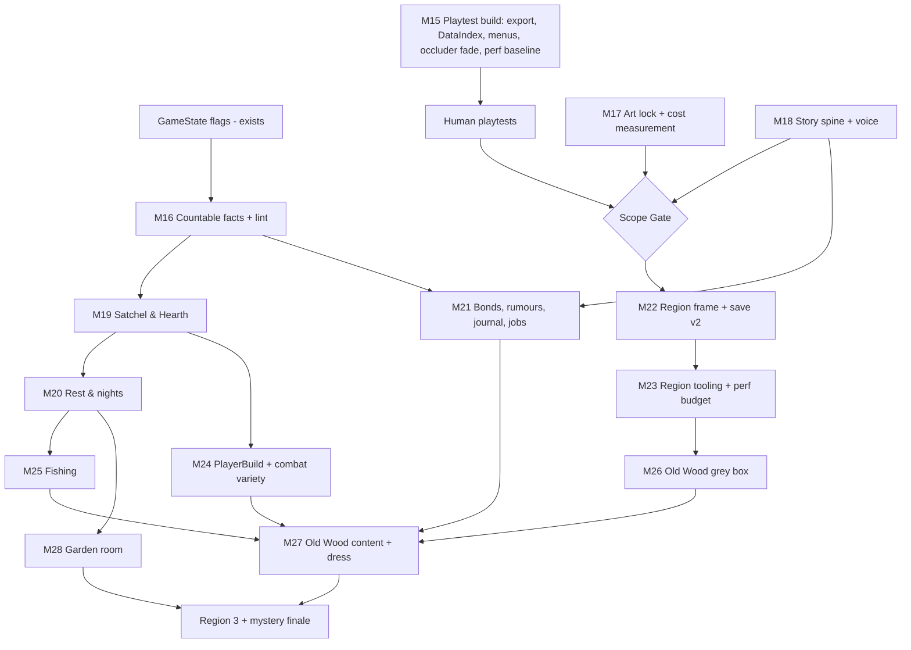

# Post-M14 Production Plan: The Wanderer's Guild

Status: **draft for review** (2026-09-29). Nothing in here has been implemented. Nothing is committed.
Produced by a six-seat council of independent agents (Game Designer, Godot Architect, Level Designer, Economy Designer, Narrative Designer, Reality Checker). Each seat answered separately, then all six anonymously peer-reviewed each other. The chairman then synthesised this plan and checked the claims against the code (see §0.3).

---

## 0. Executive summary

1. **This isn't production yet.** The slice is *technically verified but experientially unvalidated*.
   - M1–M14 are 9 commits, all dated 2026-09-28. There are 0 PNG/texture assets (12 procedural noise materials, capsule characters).
   - No human other than the developer has played it. The M14 playthrough was an autopilot.
   - Orbit/zoom feel, texel shimmer and the audio mix are listed as "not verified by hand".
   - GDD 18.1 inventory-lite and map-lite are still missing.
2. **The architecture is sound and should be extended, not replaced.**
   - One flat flag store, facts-not-steps quests, a pure seeded director, StateToggles, a flags + position + health save.
   - The gaps are narrow: conditions can't **count**, the game has **one hard-coded world**, there is **no clock**, and a **release export has never run**.
3. **Target scope: "one valley"** (unanimous after peer review).
   - 3 regions: Hub + Near Wood (the slice), the Old Wood, and one more.
   - A guild of 3–4 rooms, solo combat, 4–6 hours of play.
   - Anything bigger is earned only after region 2 has been built with *measured* cost.
4. **Next milestone: M15 "Playtest Build"** (§6).
   - A build a stranger can run: export plus smoke check, New Game/Continue with pad navigation, roof occluder fade, performance baseline.
   - Then 2–3 human playtests.
   - In parallel, M16 "Countable Facts" (numeric conditions + flag lint) is pure code with no content risk.
5. **Scale is decided by measurement, not ambition.** Before region 2 there is an explicit **Scope Gate**. It fixes the final scope from four measured numbers:
   - hours per real-art prop and character,
   - hours per side quest,
   - frame time at 3× world size,
   - human playtest verdicts.

### 0.1 Council verdict

| Seat (agent) | Stance | Avg peer rank (1 = best) |
|---|---|---|
| Reality Checker ("Skeptic") | Not production yet: validation gate first, then one valley | **1.17** |
| Godot Gameplay Scripter ("Architect") | Numeric, linted flags + region frame, then items and time as flag conventions | **1.83** |
| Narrative Designer ("Storyteller") | Bonds and rumours as counted facts; bible + lint before content | 3.33 |
| Economy Designer ("Economist") | `inv.*` ints, derived key items; food is social first; rest is the only clock | 4.67 |
| Level Designer ("World Builder") | Template-driven region 2 through the Broken Gate; tools first | 4.83 |
| Game Designer | Time as nights, quantity as counted flags; every guild system feeds exploration | 5.17 |

**Unanimous after review:**
- Region is stored in `[player]` (save v2).
- Relationships use `COUNT_AT_LEAST` over act-written beats.
- Key items are derived through `owned_when`, and only stackables are `inv.*` ints.
- Time is rest-only `world.day` with a fixed palette per region (no lighting cycle).
- Scope is one valley.
- Three seats withdrew their own first proposals: the Architect's int bond, the Game Designer's hidden-QuestData bonds and item migration, and the World Builder's region flag and region-first order.

**Sharpest disagreement:** the order after validation, i.e. Satchel vs. Region Frame vs. Story Foundation.
- Chairman's call: items and nights first, because they pay off *existing* slice content and can be playtested in the slice. Regions come after the Scope Gate. The story spine runs in parallel with the art lock.
- Minority dissent to weigh: the Game Designer seat puts numeric facts *before* the playtest build. The World Builder argues that rooms are cheap and regions expensive, so add rooms before regions if playtests say home is the hook.

### 0.2 Shared blind spots the peer review surfaced (all addressed below)
- **Content throughput is unmeasured.** Every plan was priced in code, but the real cost is art, writing and feel-testing (§6 M15/M17, Scope Gate).
- **No defined ending or main arc** (M18 Story Spine).
- **No performance budget** for larger worlds (M15 baseline, M23).
- **No plan for combat variety and balance without levels** (M24).
- **Authoring throughput:** hand-editing `.tres` graphs in the Inspector, and no way to rename flags once saves exist (M16 flag-rename migration, M23 text authoring).

### 0.3 Chairman's verification of council claims
- `DirAccess.get_files_at` scans `res://data/...` at `scripts/events/event_host.gd:18` and `scripts/ui/exploration_hud.gd:37`. In exported builds, resources can appear as `.remap` files. **Unverified**: the godot-docs MCP failed to connect this session. M15 checks it with a real export.
- `hash([...])` seeds event picks at `scripts/events/event_director.gd:52,59`. Whether Array hashing is stable across Godot versions is **unverified**. It is low cost to replace (M16).
- Player HP is written back in three places: `combat_area.gd:91/163/171` and `combat_controller.gd:458`. This is relevant only when party combat arrives.
- Props reference shared materials (`art/materials/*.tres` as ext_resources). A per-region palette therefore needs either per-region material sets or in-memory gradient swaps on region load. Both are cheap, because only one region is loaded at a time.

---

## 1. Answers to the 20 questions

### 1. Intended long-term core loop
**Session (30–60 min, 1–3 in-game days):**
1. Wake at the guild. A morning line says what changed overnight: an event fired, something regrew, someone new is at the table.
2. Harvest or check the board, and pack a meal.
3. **Follow a pull**: a rumour, a landmark seen from a vantage point, a job.
4. Explore, gather, fish, talk, and fight or avoid.
5. Walk home. Cook, give, repair, display.
6. Rest. **The overnight tick is the payoff**: you go to bed curious about what the world will do.

**Multi-week (per region):**
- Each region delivers a fixed bundle:
  - a reveal
  - a local story with ≥2 solutions
  - a guild-room material
  - one new *verb* (a tool or knowledge that opens routes)
  - one fishing spot and one seed or ingredient
  - one person who can move into the guild
  - 1–2 events
  - 2–3 mystery clues
- The horizon of each region is the next region's destination.
- The long-term hook is always "what does home look like now, and what can I reach now", never a number.

### 2. Missing systems for the full game
1. Numeric conditions and consequences
2. Items/inventory
3. Rest/time
4. Multi-region world + transitions
5. Relationships (bonds)
6. Rumours/journal
7. Notice-board jobs
8. Cooking
9. Fishing
10. Garden
11. Equipment → derived combat stats
12. Wider ability/enemy/terrain roster
13. Title/New Game/menus + pad navigation
14. Export build
15. Map-lite
16. Region authoring tools
17. Character creation (minimal)
18. Main story + ending

Companions/party combat are a *decision*, not a given (see Q17).

### 3. Foundational systems (must come first)
In dependency order:
1. **Countable facts**: `AT_LEAST`, `COUNT_AT_LEAST`, `ADD` and a flag lint. Every content file uses `DialogueCondition`, so retrofitting later means re-authoring all content.
2. **Exportable build + data index.** Silent `.remap` breakage would hit quests and events in shipped builds.
3. **Rest tick (`world.day`).** Regrowth, crops, fishing, meals and wake-up events all hang on it.
4. **Region frame (save v2).** Every region after the first depends on it.
5. **Derived player build.** Equipment, abilities from bonds and meal perks all feed combat through one pure function.

Everything else is content on top of these.

### 4. The first fully developed region
**A new region, "The Old Wood", entered through the Broken Gate**, with the Giant Tree (already a hub horizon landmark) as its hero. The slice is re-scoped as **Hub + Near Wood** (the tutorial ring) and gets *polished*, not stretched.
- The first real region is built only **after the Scope Gate**, and its size is set by measured cost. The planning target is ~280×380 m (the slice is ~125×245 m): a ~2 min critical path, a 60–90 min first visit.
- **Landmarks:**
  - 1 hero: the Tree, with walkable roots, one `CinematicReveal`, and a crown vista looking back to the guild chimney and forward to region 3.
  - 4 secondaries: a woodland community, a stream + waterfall pool, a sunken watchtower, a charcoal clearing. Each is visible from at least one other.
  - 18–24 micros.
- **Density rule:** a micro every 15–20 s of walking, a secondary every 60–90 s, never more than 30 s without a sightline or an interactable.
- **7 encounters, all visible before they engage:**
  - avoidable boars and midges
  - a *negotiable* toll-keeper (dialogue writes `encounter.*.cleared`, no combat code)
  - a fleeing creature that leads to a hidden place
  - a territorial spirit that only fights if you take its relic
  - an optional elite at the Tree
  - one event-driven encounter
- **Gathering:** 3 fishing spots and 10–12 gathering nodes.
- **3 hidden places**, one per discovery skill: readable (trail signs), followable (the creature), vantage-only (spotted from the crown).
- **Entry:** one fact, `world.gate_open`, written by three routes: beat the guardian, show a guild writ ("ghosts have paperwork"), or take the Hollow side path once the shrine is awake.
- **Return:** a one-way shortcut back into the Near Wood, about 90 s from the guild. The region is a loop, not an out-and-back.

### 5. Inventory, equipment, items, economy
- **Carried stackables** are flags, `inv.<item_id> = int`. No separate save section and no second store.
  - Stacks cap at 9. No weight and no grid.
  - About 15–25 item types for the whole game, and none that exists only to be sold.
- **Key/quest items are derived**, not stored: `ItemData.owned_when: Array[DialogueCondition]`. For example, the ring is owned when `quest.missing_ring.has_ring` is set and it has been neither returned nor kept.
  - The M9/M11 flags stay the single truth, so no migration is needed.
  - Limit: derived items can't be split or given away. That's fine for unique objects.
- **Equipment:** `equip.<slot> = "<item_id>"`, using the GDD slots (weapon, offhand, armor, accessory, utility).
  - Gear changes *verbs*: reach and range, the reaction (a shield gives Guard), exploration uses (a lantern reveals marks), routes (the glint stone makes midges ignore you).
  - The total stat budget stays within ±2 so it stays inside the d20's readable range.
  - Final stats come from a pure `PlayerBuild.actor(base, flags) -> ActorData` and are **never saved**.
- **Currency:** later, as `inv.copper`. There are no shops until a second settlement or a travelling trader exists.
  - The M14 "rent" becomes an optional **guild debt**, paid in chosen instalments at the board. The last instalment unlocks the deed or a room. It is never a timer.
  - Sinks: repairs, seeds/bait/recipes from the trader, narrative tolls.
  - The trader never sells power that can't also be found in the world.

### 6. Guild progression
Keep the M11 pattern exactly: **each room is a quest + `guild.<room>.*` flags + StateToggles.** No upgrade framework.
- Every room must **unlock a verb** and take a material from a region.
- Scope-gated list (3–4 rooms in "one valley"):
  - Common Room (done): lodgers, rumours
  - **Kitchen**: cooking, shared meals
  - **Garden**: plots
  - **Curio shelf / clue wall**: displays catches and oddities, and makes the mystery visible at home
- Stretch rooms if the valley ships on schedule: dock/boat shed, workshop (traversal tools), guest rooms.
- Progress signals stay diegetic: lit windows (already working), more people at breakfast, more notes on the board.

### 7. NPC relationships
Relationships are **memory beats written by acts, counted, never stored as a number.**
- Each NPC has 3–5 authored beat flags (`npc.wenna.beat.fish_released`, `.beat.coal_given`, ...), written by *deeds in the world*, never by talking.
- A **tier** is "at least N of these beats are set". It uses the one new test `DialogueCondition.COUNT_AT_LEAST` over a `flags` list, and the tier conditions live in shared `.tres` files (`data/npcs/wenna_bond_2.tres`).
- Why not an int bond: two routes to the same deed would double-count, and it invites grind. Why not a hidden quest: `QuestTracker` takes the first unmet objective, so deeds done out of order would stall the tier.
- **Negative memory** is its own flag (`npc.hollis.beat.ring_kept`).
- **Unlocks:**
  - tier 1: a personal line and a rumour
  - tier 2: lore, a contradiction the NPC remembers, a taught trick or recipe
  - tier 3: **the NPC moves into the guild** (`npc.<id>.resident` + a StateToggle and one room detail)
- No visible meter. Crossing a threshold is surfaced by one authored line.
- A lint rejects any beat flag that only dialogue writes.

### 8. Farming / gardening
- It is a guild room (Garden), not a separate mode.
- Seeds are discoveries from regions (night-berry cuttings, glowroot from the Hollow). There are 3–6 plots.
- Plant with an interaction: `guild.garden.p1.crop = "glowroot"`. The rest tick advances `.stage`, StateToggles on `EQUALS stage` show growth, and harvesting uses `ADD inv.*`.
- **No watering, wilting, crop death, seasons or real-time growth.** A week away costs nothing.
- **Weirdness hook:** a garden event pool evaluated on waking ("something you didn't plant came up in plot 2"), which yields a clue or a rare ingredient.
- Tie-ins: the kitchen (main sink), bond favourites, the curio shelf.

### 9. Fishing
- **Not a minigame.** A fishing spot is an `Interactable` with a catch table (`CatchData`: fish, weight, conditions). Cast, see a ~1.5 s bobber beat with no input, and catch.
- The catch is **deterministic**, seeded like the director (`day`, spot, seed), so reloading never rerolls. One catch per spot per rest.
- **Fishing is exploration:**
  - Some fish exist only after events (`world.pond_glows` → lantern carp, which finally pays off the Glowing Fish).
  - Some live only in new regions, and one appears only once the mystery has advanced.
- A **fish ledger** on the curio shelf is a collection *of places*, with silhouettes for unknowns.
- Tie-ins: the kitchen, bond favourites, mystery clues (scales in the wrong constellations).

### 10. Cooking / food
- **Food is social first, preparation second.**
  - Cooking a favourite for someone is a bond beat. Meals shared at the hearth change breakfast lines and bring lodgers.
- **One active meal** (`player.meal = "<id>"`), cleared by the rest tick. Each meal gives one *sideways* perk, never a bigger number. Examples:
  - Night-berry tart: +2 temporary HP
  - Ember tea: faster recovery
  - Owl-eye broth: reveals hidden interactables gated on the meal
  - Bitter root: immune to Dazzled
- Recipes are known facts (`recipe.<id>`), learned from bonds, found notes, or trying a listed combination.
- **No hunger, spoilage or stamina.** A balance rule, checked by a headless test: food is an option, never required. A no-food build must clear every encounter at a similar rate.

### 11. Scaling quests, rumours and events
- **Rumour pipeline:** NPC/board/document/event → `rumour.<id>.heard` → journal line (what and roughly where, no marker) → `discovered.<place>` → optional quest.
  - A rumour is `QuestData` with `kind = RUMOUR`: add a `kind` enum {QUEST, RUMOUR, JOB}, not a new class.
  - A rumour **never gates** its discovery: walking there unprompted writes the same fact.
  - The journal is a derived screen (Heard / Doing / Done) with no saved state.
- **Jobs vs. authored quests:**
  - Authored quests are multi-route and change NPCs and landmarks.
  - Jobs are small, absurd, one route is fine. **The EventDirector posts them**: a village `EventData` whose `start` writes `job.<id>.posted`. The board is a speaker-less `DialogueData`. ONCE jobs only at first.
- **Event pools** are just more `EventData` per region. There is no tag system until the director needs to query by something flags can't express.
  - Rule, enforced by lint: **every resolved event leaves a trace**: a StateToggle, a changed NPC line, or a new rumour.
- **Mystery thread:**
  - `mystery.stage.N` is advanced via `COUNT_AT_LEAST` over discoveries and anomaly beats.
  - Every pool gets a rare stage-gated *anomaly variant* (like the Glowing Fish world-anomaly variant).
  - NPCs remember the same fact differently, and it is never resolved.
  - The truth, the reveal ladder and a **register of intentional inconsistencies** (which the continuity editor must not "fix") live in the bible.

### 12. Scaling regions and landmarks
- **Separate region scenes + `_swap_world` transitions on physical thresholds** (a pass, bridge, gate or ferry landing). No streaming.
  - A `RegionExit` area fades (~0.6 s) and swaps.
  - The player spawns at `Entries/<from>` facing that region's hero.
  - It is refused at unsafe moments (same rule as `EventHost.is_safe`) and is never an event opportunity.
- **Region template** (`scenes/world/region_template.tscn`):
  - `Ground`, `Edge/Wall|Trees|Rises`, `Anchors/*`, `Entries/*`, `Exits/*`, `Landmarks/Hero|Secondary`, `Horizon/*`
  - `Events` + `EventRegion`s, `AmbienceZone`s, `WorldEnvironment`
- **`RegionData`:** `id`, `scene`, `title`, `world_offset` (one shared world frame), palette.
  - Hero landmarks get cheap far **impostors** placed in neighbouring regions at the correct bearing, and a test checks the bearing. That is the "the next region's hero is on this horizon" pipeline.
- **Budget per region:**
  - 1 unique hero + 1 reveal (never two reveals in a medium region)
  - 3–4 kitbashed secondaries
  - ~20 micros that are 100% reuse
  - 2–3 horizon impostors (forward, home, and the Floating Island as the persistent world anchor)
- **Identity per region:** WorldEnvironment (fog, sun) plus gradient swaps on the 3–4 most visible shared materials. The warm/cool rule holds everywhere.
- **Travel:** walking is the travel. Regions loop and have shortcuts, form a graph rather than spokes, and earned diegetic routes (a cart, a ferry) are guild upgrades between *inhabited, discovered* places. Camps are rest/save points, not warps. Map-lite shows discovered places only.

### 13. Progression without a level grind
The player grows along six axes. None of them is XP.
1. **Reach**: tools and knowledge open routes. This is the metroidvania-lite spine and the main driver.
2. **Knowledge**: map, recipes, catch tables, **creature knowledge**. Knowing what a creature wants adds non-combat options ("monsters have jobs"), which makes combat optional where the fiction permits.
3. **People**: bonds, residents, favours that open doors.
4. **Home**: rooms, services, the look of the guild.
5. **Kit breadth**: about 8 abilities by the end (from bonds, shrines, gear), at most 3 slotted, so there is always a choice.
6. **Preparation**: meals and gear as sidegrades.

Raw stats barely move: HP goes from 12 to about 20 over the whole game.

### 14. What remains data-driven
- **Keep:** `ActorData`, `AbilityData`, `StatusData`, `EncounterData`, `DialogueData` (+ node/choice/condition/consequence), `QuestData` (+ objective/outcome), `EventData`/`EventVariant`, `sound_bank`.
- **Add, each when its milestone needs it:**
  - `ItemData`: id, name, description, icon, category, `stack_max`, `owned_when`, slot, mods within ±2, `grants_ability`/`grants_reaction`, `use_status`, `lore_lines`
  - `RecipeData`: inputs `{id: count}`, output, count, `requires` conditions (the station is a condition)
  - `CatchData`
  - `RegionData`
  - shared bond-tier condition `.tres` files
  - later `ShopData` and a minimal `ArchetypeData`
- **Not new types:**
  - a job or rumour is `QuestData.kind`
  - a companion/resident is `ActorData` + `DialogueData` + flags
  - time/weather filters on events are `conditions` on flags
  - a room upgrade is a quest

### 15. Architectural extensions needed before production
Each extension keeps "one source of truth".

| Extension | Minimal change | Files |
|---|---|---|
| Countable facts | `DialogueCondition.Test` += `AT_LEAST`, `COUNT_AT_LEAST` (+ `flags: PackedStringArray`); `DialogueConsequence.Kind` += `ADD` (int delta, clamped at 0); one shared `GameState.apply(consequence)` replaces the duplicated SET_FLAG rule | `dialogue_condition.gd`, `dialogue_consequence.gd`, `game_state.gd`, `dialogue_runner.gd`, `event_director.gd` |
| Flag lint | Headless test over all `.tres`: read-but-never-written, written-never-read (esp. `rumour.*`, `event.*.resolved`), unknown prefix, unknown item id, beat flags written only by dialogue | `tests/test_flag_lint` |
| Data index | One static `DataIndex` for id lookups (quests, events, items, regions) that works in exports | replaces the two `get_files_at` scans |
| Deterministic hash | Replace `hash([...])` with a small fixed hash (e.g. FNV over a joined string) so an engine upgrade can't reroll saved games | `event_director.gd` |
| Rest tick | Pure `Overnight.advance(flags)`: `world.day += 1`, clears per-day flags, advances crops, then `EventDirector.evaluate` once (the "second opportunity source" M10 already anticipates) | new `scripts/core/overnight.gd` |
| Items | `inv.*`/`equip.*` conventions; `Interactable.gives_item`/`count` next to `sets_flag` | `interactable.gd` |
| Derived player build | `PlayerBuild.actor(base, flags)`; `CombatArea` and `Player.max_health` read it | `combat_area.gd:90`, `player.gd` |
| Regions | `RegionData` registry; `main.change_region(id, entry)` reusing `_swap_world`; `MAIN_WORLD` → "any registered region may save"; save v2 adds `[player] region` (migration v1 → `slice_region`); a lint that `EventRegion` ids are unique across regions | `main.gd`, `save_game.gd` |
| Flag rename | A migration-step helper that renames keys, so the content can be refactored after saves exist | `save_game.gd` |

### 16. What the save should eventually persist
- **Persist:**
  - `GameState.flags`: world facts, quests, events and director bookkeeping, inventory counts, equipment, bonds, `world.day`, meal, crops, recipes, currency
  - `[player]`: region, position, health (health moves to `actor.<id>.hp` flags only if party combat ever arrives)
  - `[save] version`
  - later, a small `[meta]` (play time, region title) per slot for a slot list
  - settings stay in their own file
- **Stay derived:** final stats/ActorData, max HP, abilities; quest/journal/HUD state; StateToggles, interiors; map reveals (from `discovered.*`); shop stock; inventory UI; NPC placement; camera.
- **Never saved:** fights, conversations, cinematics (saving stays refused during them).

### 17. Do NOT build yet
- Regions 4–8.
- Party combat and companion AI. Decide solo vs. party at the Scope Gate. Default: **solo** combat; residents and an animal companion are flavour.
- Dynamic day/night and weather. Use a fixed palette per region.
- Character creation beyond a name. Crafting beyond cooking. Shops before a second settlement.
- Durability, weight, rarity tiers, loot tables, affixes. XP and levels. Hunger, stamina, spoilage.
- Romance, approval meters, NPC schedules, real-time clocks, fishing or cooking minigames.
- A visible relationship meter. Map markers. Editors (quest/encounter/map tools) until the same thing has hurt three times by hand. A generic upgrade or crafting framework.
- Main-story dialogue volume before the art lock and the one-page spine.

### 18. Smallest sensible next milestone
**M15 Playtest Build** (details in §6).
- It turns the slice into something a stranger can run and judge.
- It retires the two cheapest-to-find, most expensive-to-discover-late risks: the untested export and first-impression camera loss.
- It produces the first measured numbers. Everything else waits on those numbers.

### 19. Milestone dependencies
See §3 (graph) and the "Depends on" line of every milestone in §6.

### 20. Technical risks (ranked)
1. **Art fails with real assets.** Shimmer, or unreadable characters at 640×360. The pipeline, the FOV decision and possibly the style (the GDD 19.3 low-poly fallback) all change. → M17 before any content spend.
2. **Conditions that can't count, found out late.** Every content file uses `DialogueCondition`. → M16.
3. **Silent export breakage** (`.remap` scans). → M15.
4. **Untyped flag keys at scale.** A typo reads as false and content silently never fires. → M16 lint.
5. **Party combat bolted on later.** It touches `CombatState`, the AI, the HUD, 3 HP write-back sites and every encounter. → decide at the Scope Gate.
6. **Day/night added after regions exist.** Every reveal and fog composition would need a re-audit (the overlook's return frame is already at its pitch limit). → fixed palettes.
7. **Performance at 3× world size.** Per-instance trees, per-object lights, fog, SubViewport. → baseline in M15, budget in M23 (MultiMesh/visibility ranges only when measured).
8. **Event reroll after an engine upgrade** (`hash()`). → M16.
9. **Hand-built 3,662-line region scenes** (the `node_paths` pitfall, copy-paste drift). → template + generator in M23.
10. **Single-world save gate.** → M22.

---

## 2. Proposed architecture changes (summary)
There is no new manager, no new store and no rewrite. All of these are extensions:
- `DialogueCondition`: `AT_LEAST`, `COUNT_AT_LEAST`. `DialogueConsequence`: `ADD`. `GameState.apply()` as the single consequence rule.
- `DataIndex` (id → Resource, export-safe). A fixed hash in `EventDirector`.
- `Overnight.advance(flags)` as the second event-opportunity source.
- `ItemData` (+ `owned_when`), `inv.*`/`equip.*` flag conventions, `Interactable.gives_item`.
- `PlayerBuild.actor(base, flags)` derived at combat start and for max HP.
- `QuestData.kind` (QUEST/RUMOUR/JOB) plus a derived journal screen.
- `RegionData`, `RegionExit`, `main.change_region`, save v2 with `[player] region`, and a flag-rename helper in the migrations.
- Tests/lints: `test_flag_lint`, `test_narrative`, generalised anchors/region test, bearing test, balance simulation.
- New flag prefixes, documented in `game_state.gd` and `docs/story/flags.md`: `inv.`, `equip.`, `recipe.`, `rumour.`, `job.`, `mystery.`, `npc.<id>.beat.`, `npc.<id>.resident`, `world.day`, `player.meal`.

---

## 3. Production dependency graph

Critical path: **M15 → playtests → (M17 ∥ M18) → Scope Gate → M22 → M23 → M26 → M27.**
M16, M19, M20 and M21 run alongside it inside the existing slice, and each can be playtested there.

---

## 4. Milestone roadmap

Every milestone follows the house rules: headless test for system correctness, scripted screenshots + audit in DECISIONS for player experience, all suites green, `git diff --check` clean.

### M15: Playtest Build (NEXT)
- **Purpose:** make the slice runnable and judgeable by a stranger; retire the export risk; get the first measurements.
- **Player-facing result:**
  - a title screen with **Continue / New Game** (New Game confirms before overwriting the one slot), fully pad-navigable
  - roofs dither-fade like tree crowns do when they hide the player (M5's crown fade extended; fixes the M11 "camera pull-in behind the guild" backlog)
  - an exported Windows build
- **Systems affected:** `main.gd` (title/start flow), UI (new `scenes/ui/title.tscn`), roof materials (distance fade), event/quest lookup (`DataIndex`), `export_presets.cfg`.
- **Dependencies:** none.
- **Data structures:** `DataIndex` (static id → path map, export-safe). No save change.
- **Tests:**
  - `test_data_index`: all quest and event files found by id.
  - An **export smoke run**: the exported build started with a flag prints the quest and event counts, which must match the editor.
  - Title-flow checks in `test_save`: New Game doesn't touch the save until the first save; Continue loads.
  - **Performance baseline:** frame time + draw calls at 3 fixed camera poses in the slice, and the same with the Near Wood duplicated 3×. Recorded in DECISIONS, not a pass/fail.
- **Then (human, not code):** 2–3 playtests by people other than the developer, using `docs/PLAYTEST.md`, with no guidance. Score them against GDD 18.2 and record them in DECISIONS.
- **Out of scope:** settings menu, save slots, new content, art, balance changes (they wait for playtest data).

### M16: Countable Facts
Runs in parallel with the playtests.
- **Purpose:** close the "conditions can't count" gap before any content depends on it.
- **Player-facing result:** none directly. One visible proof: Hollis's line changes once 2 of 3 village deeds are done (ring returned, fish released, repair made).
- **Systems affected:** `DialogueCondition`, `DialogueConsequence`, `GameState` (`apply`), `DialogueRunner`, `EventDirector` (shared apply + fixed hash), `SaveGame.migrations` (a rename helper, unused until needed).
- **Dependencies:** none.
- **Data structures:** `Test.AT_LEAST` (a missing flag = 0), `Test.COUNT_AT_LEAST` + `flags: PackedStringArray`, `Kind.ADD` (int delta, clamp ≥ 0, validated as an int).
- **Tests:**
  - `test_dialogue` + `test_events` gain numeric pass/fail cases, missing = 0, ADD clamping, and COUNT as OR (N = 1).
  - **All existing content re-validates unchanged.**
  - The fixed hash gives the same event per seed across runs (new expected values are recorded once).
  - `test_flag_lint` passes on the current content. It must flag `rumour.old_wood_lights`, which nothing reads: give it a reader or an allow-list entry.
- **Out of scope:** items, UI, `LESS_THAN` (add it when content needs it), expression languages.

### M17: Art Lock
One corner, real assets.
- **Purpose:** answer GDD 19.3 with real art, and **measure the cost** per prop and per character.
- **Player-facing result:**
  - the guild exterior, the well, one tree, one rock and one character (idle/walk/interact, placeholder attack), made with the aseprite MCP / PixelLab at 32 texels/m
  - seen in the free camera at all yaws and both ends of the zoom rail
- **Systems affected:** `art/`, the materials of those props, the player's visual.
- **Dependencies:** M15 (build for side-by-side renders). Human playtest notes help.
- **Data structures:** none. `docs/ASSET-SOURCES.md` entries.
- **Tests:**
  - scripted shots at yaw 0/90/180/270 and zoom 6.5/28, before/after
  - a **manual texel-shimmer check while rotating** (never verified so far)
  - a hours log per asset recorded in DECISIONS
- **Out of scope:** re-arting the rest of the slice, animation beyond the set above, UI art.

### M18: Story Spine & Voice
Runs in parallel with M17.
- **Purpose:** define what "finished" means and give every later line a voice.
- **Player-facing result:**
  - every slice line rewritten in character (the slice becomes the style reference)
  - Wenna trimmed to at most 4 visible choices
  - one seeded "disagreeing memory" clue
- **Systems affected:** `data/dialogue/*.tres` (text only), `docs/story/`.
- **Dependencies:** none (text). M16 is needed only for the lint part.
- **Data structures:**
  - `docs/story/spine.md`: one page covering the main arc across 3 regions, **the ending**, and the fate of the island and gate
  - `bible.md` with the truth, the reveal ladder and the intentional-inconsistency register
  - `tone.md` (60/25/15 with examples; ~180 characters per node; ≤4 choices)
  - `characters/` (roster + voices; the player's voice: terse, choice-driven)
  - `flags.md`
- **Tests:**
  - `test_narrative`: line and choice limits, speakers from the roster, no placeholders, `event.*.resolved` read somewhere; merged with the flag lint
  - **a timed authoring of one complete side quest**, with hours recorded (the throughput number)
- **Out of scope:** new NPCs, new quests, main-story dialogue volume.

### Scope Gate (decision, not code)
- **Inputs:** M15 playtest verdicts, M15 performance baseline, M17 hours per asset, M18 hours per quest.
- **Output**, recorded in DECISIONS:
  1. confirm or cut "one valley"
  2. size of the Old Wood
  3. **solo vs. party combat** (default solo)
  4. art go / low-poly fallback
  5. whether the next guild room comes before region 2 (if playtests say home is the hook)

### M19: Satchel & Hearth
- **Purpose:** add items and pay off existing slice content.
- **Player-facing result:**
  - picking night-berries now gives berries
  - the fish bucket offers "Keep one"
  - an **I / pad Select** satchel panel (a list grouped by category, with descriptions; key items like the ring, glint stone, timber and coal shown while owned)
  - the repaired hearth offers **Cook** (tart, broth)
  - eating gives **Well-fed**
  - Maren accepts "Share a tart" (her first beat)
- **Systems affected:** `Interactable` (`gives_item`/`count`), `fish_bucket.tres`, the hearth dialogue, `lodger.tres`, new `scripts/items/`, HUD panel, combat start (the status is applied).
- **Dependencies:** M16.
- **Data structures:** `ItemData` (+ `owned_when`), `RecipeData`, `inv.*` flags, `player.meal`, one `StatusData` "well_fed".
- **Tests:**
  - `test_inventory`: grant/consume/cap 9/never negative; derived key items appear and disappear with their quest facts; the recipe needs its inputs; survives save/load; an old M14 save loads unchanged
  - a balance check that the guardian can be beaten without food
- **Out of scope:** equipment, currency, shops, storage/pantry, the kitchen room, fishing spots.

### M20: Rest & Nights
- **Purpose:** add a player-chosen clock.
- **Player-facing result:**
  - a bed in the common room: **Rest** fades out and in to "Day 4", with a **morning line** listing what changed
  - full heal
  - the meal expires
  - night-berries regrow per rest (the existing event, now also on waking)
- **Systems affected:** new `Overnight`, `EventHost` (a wake opportunity), the berries event, `player.gd` (heal), the guild scene (bed).
- **Dependencies:** M19 (meals expire), M16.
- **Data structures:** `world.day` int, a per-day flag convention (`*.today`), cleared by `Overnight`.
- **Tests:** `test_rest`:
  - a rest advances exactly one day and gives exactly one event opportunity
  - it doesn't move `last_region` (so there's no false opportunity)
  - cooldowns count
  - per-day flags clear
  - same flags + seed → same morning
  - save/load mid-day
- **Out of scope:** lighting phases, weather, NPC schedules, camping outside the guild (it comes with regions).

### M21: Bonds, Rumours & the Board
- **Purpose:** make relationships and curiosity systems, using content that already exists.
- **Player-facing result:**
  - beat lists for Wenna, Hollis and Maren, with one threshold line each
  - Hollis remembers a kept ring
  - **one NPC moves into the guild** (a room detail appears)
  - a **journal** screen (Heard / Doing / Done)
  - `rumour.old_wood_lights` finally points at the Hidden Hollow
  - the notice board is readable, with 2 absurd ONCE jobs posted by village events
- **Systems affected:** dialogue data, `QuestData`/`QuestTracker` (kind filter), HUD (only QUEST/JOB in the corner), a new journal UI, village `EventData`.
- **Dependencies:** M16, M18 (voices).
- **Data structures:** `QuestData.kind`, shared tier-condition `.tres` files, `npc.*.beat.*`, `npc.*.resident`, `rumour.*`, `job.*`.
- **Tests:**
  - `test_quest` (kind filter; a rumour closes silently when the place is found unprompted)
  - `test_narrative` (beats never written only by dialogue; every `rumour.*` has a reader; every resolved event leaves a trace)
  - a resident appears through a StateToggle after a reload
- **Out of scope:** companions in combat, gifts as a system, prices, map markers, repeatable jobs.

### M22: Region Frame
After the Scope Gate.
- **Purpose:** make more than one region possible.
- **Player-facing result:**
  - the **Broken Gate opens** (`world.gate_open` via guardian / guild writ / Hollow route)
  - walking through fades into a grey-box stub region, and a return exit comes back
  - saving and loading works in either region
- **Systems affected:** `main.gd` (`change_region`, save allowed in any registered region), `SaveGame` (v2), new `RegionExit`, `RegionData`, the gate content.
- **Dependencies:** Scope Gate, M15 (`DataIndex`).
- **Data structures:** `RegionData` (id, scene, title, `world_offset`, palette), `[player] region`, migration v1→v2 (default `slice_region`).
- **Tests:** `test_regions`:
  - a swap keeps flags and HP
  - spawn at the entry marker
  - an unsafe exit is refused
  - no event opportunity from the swap
  - `EventRegion` ids are unique across regions
- `test_save`: v1→v2 migration, round trip in region 2.
- **Out of scope:** region content, travel services, streaming, map.

### M23: Region Tooling & Performance Budget
- **Purpose:** build regions from a template and measure them, instead of hand-copying the slice.
- **Player-facing result:**
  - none directly
  - the slice's edge is regenerated by the tool, identical in play
- **Systems affected:** `tools/` (`@tool` scripts), tests.
- **Dependencies:** M22.
- **Data structures:**
  - `region_template.tscn`
  - an edge/blockout generator (wall + edge trees + rises from one `Path3D`; trail meshes)
  - a sightline manifest (per anchor: which goal must be visible, from which yaw/zoom)
  - horizon impostor scenes
- **Tests:**
  - a generalised anchors test over every region (edge loop closed; anchors, entries and exits inside it; exit partners exist; no edge tree in a CombatArea; ids unique; horizon bearings consistent)
  - a batch sightline-shot run for human audit
  - the **walk-timing autopilot kept as a tool** (seconds between POIs, stuck spots)
  - a **performance budget** set from the M15 baseline (MultiMesh or visibility ranges only if the numbers demand them)
- **Out of scope:** a terrain plugin, level editors, streaming.

### M24: Kit & Combat Variety
- **Purpose:** keep combat interesting for 4–6 hours without levels.
- **Player-facing result:**
  - 2–3 new abilities obtainable in the world (one taught by a bond, one from gear)
  - 1–2 equippable items that change verbs (e.g. a spear with 2.5 m reach, a lantern that marks hidden things)
  - one new terrain type from GDD 8.3 (brambles or fire)
  - 2 new enemy roles, including one negotiable or fleeing creature
- **Systems affected:** new `PlayerBuild`, `CombatArea` (uses the derived actor), `combat_state.gd` rules, ability/actor data, AI brains.
- **Dependencies:** M19 (items), M21 (bond-taught ability).
- **Data structures:** `equip.*` flags, `ItemData` slot/mods/`grants_*`, the new `AbilityData`/`ActorData`/`StatusData`.
- **Tests:**
  - `test_player_build` (mods add up within ±2; granted abilities appear; nothing saved)
  - `test_combat_rules` (the new terrain and abilities)
  - a **headless balance simulation**: the AI plays the player's side against every encounter, with and without food, and reports HP lost, turns and loss rate within bounds
- **Out of scope:** party combat, levels, loot, flanking.

### M25: Pond & Stream Fishing
- **Purpose:** make fishing an exploration payoff.
- **Player-facing result:**
  - a rod from Hollis (a bond beat)
  - the village pond and forest stream as spots
  - the **lantern carp only after the Glowing Fish** is released into the pond
  - a fish ledger shelf in the guild
- **Systems affected:** `Interactable` + a catch script, `Overnight` (clears catches), the guild scene, recipes (a fish dish).
- **Dependencies:** M20, M19.
- **Data structures:** `CatchData` (spot, fish, weight, conditions), `fish.<spot>.today`, a `ledger.<fish>` flag.
- **Tests:** `test_fishing`:
  - deterministic catch per seed/day/spot
  - one per spot per day
  - conditional fish only after the fact
  - reload never rerolls
- **Out of scope:** minigames, bait systems, deep-water fishing.

### M26: The Old Wood, Grey Box
- **Purpose:** lock the region layout before any art.
- **Player-facing result:**
  - the whole region in grey box, sized by the Scope Gate
  - the Tree silhouette + its reveal
  - the critical path, 4 secondaries and the loop shortcut home
  - placeholder encounters
  - the Tree impostor updated on the hub horizon
- **Systems affected:** the new region scene from the template, the hub horizon.
- **Dependencies:** M22, M23.
- **Data structures:** a `RegionData` entry, anchors, sightline manifest entries.
- **Tests:**
  - the anchors test for this region
  - the autopilot meets the density rule with 0 stuck spots on designed routes
  - the sightline shots pass
  - the reveal test (as in `test_reveal`)
  - the performance budget holds
- **Out of scope:** dressing, dialogue, new systems.

### M27: The Old Wood, Content & Dress
Expected to split into 2–3 milestones at planning time.
- **Purpose:** make the region worth the walk.
- **Player-facing result:**
  - the 7 encounters (including negotiate, avoid and follow)
  - the woodland community + one resident candidate
  - 2 multi-route quests + 3 jobs
  - a region event pool with an anomaly variant
  - 3 fishing spots, gathering nodes, 3 hidden places
  - hub rumours pointing there
  - the region palette and a unique Tree mesh
  - a crown vista showing region 3's hero
- **Systems affected:** content only (data, scenes, art).
- **Dependencies:** M26, M24, M21, M25, M17 (art go).
- **Tests:** all validators and lints; region test; balance sim over the new encounters; scripted route renders; DECISIONS audit; **hours logged** per asset, quest and encounter.
- **Out of scope:** region 3, travel services, new rules.

### M28: Garden Room
- **Purpose:** make the guild grow food from what you discover.
- **Player-facing result:**
  - a garden repair quest
  - 3 plots
  - seeds from the Near Wood and the Old Wood
  - growth per rest shown by StateToggles
  - one garden event ("something you didn't plant")
- **Systems affected:** guild scene, `Overnight`, garden event data, recipes.
- **Dependencies:** M20, M27 (the second seed source).
- **Data structures:** `guild.garden.p<N>.crop` / `.stage`, seed `ItemData`.
- **Tests:** `test_garden`:
  - planting needs a seed
  - growth only on rest
  - never withers
  - harvest ADD
  - the garden event lands on waking only
- **Out of scope:** watering, seasons, more than 3 plots.

### Beyond M28 (sequenced at the next planning pass)
- Region 3 and the mystery finale (to the spine)
- The kitchen room (if not already folded into the hearth)
- Curio shelf / clue wall
- Guild debt and copper + one travelling trader
- Map-lite
- Save slots + settings
- A full art pass of the hub
- A minimal character setup (a name + one visual choice)

---

## 5. Recommended next milestone
**M15 Playtest Build**, with **M16 Countable Facts** as the parallel code task while the playtesters play.
- M15 is small, code-only, and needs no design decision. It retires the export risk (the `.remap` scans) and the worst first-impression bug (the camera losing the player behind roofs). It is also the prerequisite for the most valuable information still missing: *does a stranger enjoy this?*
- M16 is the cheapest insurance against the most expensive late rewrite: every `.tres` file depends on what conditions can express.

---

## 6. Risks
The technical ranking is in Q20. Production risks:
- **Throughput risk (highest).** Code was the cheap part: 14 milestones of systems in one day. Art, writing quality and human feel-testing will dominate, and none of them is measured yet. Mitigation: M15/M17/M18 measure; the Scope Gate decides; M27 logs hours.
- **Scope risk.** The GDD's full world (8 regions, companions, crafting, character creation) is multi-year studio work. At an estimated 1–3 months per region for a hobby developer, "one valley" is ~12–18 months if the art gate passes. This is a council estimate, unmeasured.
- **Claude Pro budget.** Agent-heavy work (councils, many renders) is expensive. Keep councils for decisions like this one; build milestones with one agent at a time.
- **Checklist drift.** More rooms, fish, crops and jobs can turn the game into a to-do list. Every system must feed exploration (the pull) or home (the return), and the lint enforces "every event leaves a trace".
- **Design risk without an ending.** Until `spine.md` exists, content can't be prioritised. M18.
- **Combat monotony.** One solo unit and 3-s/HP regen could flatten difficulty. M24 adds the balance sim before region 2 fills up with fights.

---

## 7. Explicitly deferred features

### From the GDD
Regions 4–8, party combat and companion AI (pending the Scope Gate), character creation beyond a name, crafting beyond cooking, shops before a second settlement, dynamic day/night, weather, NPC schedules, romance, approval meters, a world-map screen before region 2, quest/encounter/map editors, flanking.

### M14 backlog (`task_plan.md` "Open risks")

| Item | Decision |
|---|---|
| Inventory-lite | **M19** |
| Roof/crown occluder fade (camera pull-in behind roofs) | **M15**: fix before any content scale-up |
| No New Game/title menu; pad players can't save | **M15** (title + pad navigation; autosave covers saving) |
| Texel shimmer during rotation (never checked by hand) | **M17** |
| Guardian fight is long; Ruin Slam balance | **M24**, with playtest + balance-sim data, not before |
| Smart attack movement | Deferred; pulled in only if playtesters hit it |
| Distant ruin aliasing at 100 m+ | Deferred to the art pass (the material gets replaced anyway) |
| Island flat/grey in fog; reveal pitch cap clips the island top | Deferred to the art pass |
| Spring-arm pull-in when the reveal starts on side slopes | Deferred (polish) |
| Guild dollhouse look at indoor LOOK zoom; subtle damage detail; no fire sound | Deferred (art/audio pass) |
| `reveal` reuses the discovery sting | Deferred (audio pass) |
| Quest corner layout if quests multiply | Revisit in **M21** (journal takes rumours out of the corner) |
| Intermittent Ogg leak at test exit | Deferred (harmless) |
| One save slot / `--fresh` overwrite trap | **M15** covers the trap (New Game confirms); slots deferred |
| Controller menus | **M15** for title/pause; the rest arrives with each new screen |

---

## 8. Files inspected
- **Docs:** `CLAUDE.md`, `docs/GDD.md`, `docs/DECISIONS.md`, `docs/PLAYTEST.md`, `docs/MASTER_PROMPT.md` (headings), `task_plan.md`, `progress.md`, `CODEX_CONTINUATION.md`.
- **Code:**
  - `scripts/core/game_state.gd`, `scripts/core/main.gd`, `scripts/save/save_game.gd`, `scripts/player/player.gd`, `scripts/interaction/interactable.gd`
  - `scripts/world/state_toggle.gd`, `scripts/events/event_data.gd`, `event_director.gd`, `event_host.gd`
  - `scripts/quests/data/quest_data.gd`, `quest_objective.gd`, `quest_tracker.gd`
  - `scripts/dialogue/data/dialogue_condition.gd`, `dialogue_consequence.gd`, `dialogue_runner.gd`
  - `scripts/combat/data/actor_data.gd`, `encounter_data.gd`, `ability_data.gd`, `combat_area.gd`, `combat_state.gd`, `combat_controller.gd`
  - `scripts/ui/exploration_hud.gd`, `scripts/camera/cinematic_reveal.gd`
- **Scenes and data:** `scenes/world/props/tree.tscn`, `rock.tscn` (material binding), `scenes/world/slice_region.tscn` (size, edge), `data/**` (all current Resources), `tests/*.gd`.
- **Git:** `git log`, `git status`.

Council members read overlapping subsets of these. The chairman verified the load-bearing claims listed in §0.3.
